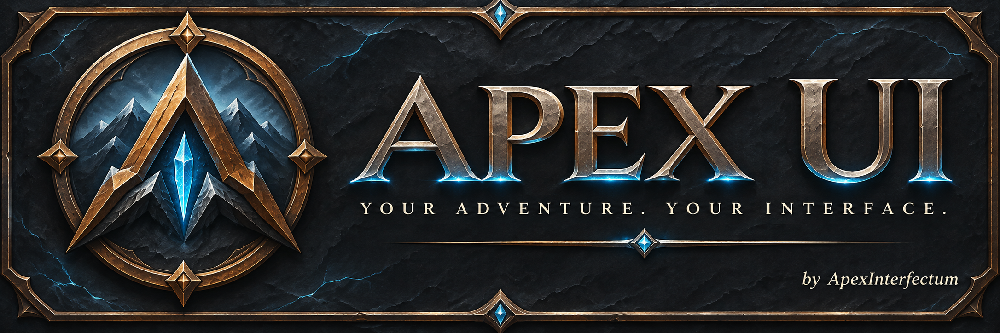
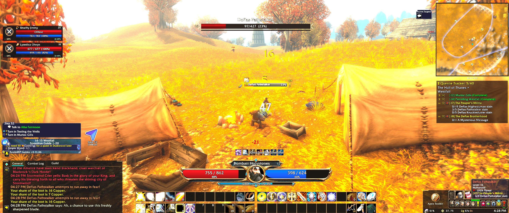

# ApexUI

**A standalone Warcraft-inspired interface and adventuring toolkit for WoW Forever.** Created by **ApexInterfectum**, published here by RyanVerWey.

Bronze borders, readable frames, independent action bars, and practical tools that share one visual style. No Ellesmere UI installation is required.

**[Download 0.3.0 Standalone Beta](https://github.com/RyanVerWey/ApexUI/releases/tag/v0.3.0)** · **[Report a bug](https://github.com/RyanVerWey/ApexUI/issues)** · **[CurseForge](https://www.curseforge.com/wow/addons/apexui)**

## Install with WowUp

1. Select your **WoW Forever** installation in WowUp.
2. Choose **Get Addons → Install from URL** and paste `https://github.com/RyanVerWey/ApexUI`.
3. Allow **Beta** releases for ApexUI, since 0.3.0 is a prerelease.
4. Install, then restart WoW if this is your first installation.

Use the repository URL for future update detection. Direct ZIP installation does not provide the same update tracking. Searchable WowUp Hub indexing is separate from installation by URL.

For manual installation, download `ApexUI-0.3.0-forever.zip` from the release. Extract **all five folders** into `World of Warcraft/_forever_/Interface/AddOns/`: `ApexUI`, `ApexFishing`, `ApexNavigator`, `ApexGrind`, and `ApexProfessions`. The four small companion folders preserve saved data; their features run within ApexUI.

**Supported client:** WoW Forever 1.60.1, interface 16001. Retail and other Classic branches are not claimed as supported. Back up your WTF settings before changing UI providers.

## Your HUD, your layout

- Player, companion, target and party frames, with readable health, resources, XP and percentages.
- Independent action bars, floating auras, styled chat with General and Guild tabs, minimap and bag controls.
- Named layouts, shared defaults and separate character configurations.
- An Apex Toolkit launcher for opening tools without filling the screen with permanent panels.

## Included tools

| Tool | What it does |
| --- | --- |
| Apex Fishing | Skill-aware fishing and cooking guidance, compact fishing controls and destination markers. |
| Apex Navigator | Coordinate destinations and routes using available travel connections. |
| Apex Grind | Live XP rates, rested-XP estimates, grinding recommendations and material filters. |
| Apex Professions | Gathering and crafting paths, trainer and recipe guidance, and cost estimates using supported auction-price data when available. |
| Apex Combat | Reactive damage tracking, totals between fights and dungeon-session summaries. |

Recommendations and prices are estimates. Custom server changes, travel availability, auction data and player performance can change the best route. Combat and fishing actions still require player input.

## Quick controls

| Command | Opens or changes |
| --- | --- |
| `/apexui` | Toolkit and settings |
| `/apexui layouts` | Named layouts and character defaults |
| `/apexbars` | Bar visibility, rows, button counts and sizes |
| `/apexframes auto` | Automatic solo or companion frame layout |
| `/apexframes motionoff` / `/apexframes motionon` | Resource-bar animation |

Layout settings include movers for frames and bars. Existing macros and key bindings remain available. See the [addon guide](ApexUI/README.md) for migration and recovery details.

## In game



Actual in-game screenshot. Questie, RestedXP and external overhead nameplates shown here are separate addons and are **not bundled**. Logos and artwork use the same ApexInterfectum branding as the CurseForge project.

## Beta status and local verification

The release has been checked with Lua 5.1 regression tests, package-integrity checks and live UI walkthroughs. Coverage includes layout migration, action pages, bindings, party frames, PvP indicators, combat accounting, tool panels and guide calculations. Completed dungeon runs, real crafting transactions and broader class/display coverage remain beta testing areas.

No GitHub Actions are used. To run the portable checks and build the reviewed package locally:

```sh
python -m pip install -r requirements-dev.txt
python tools/test_all.py
python tools/build_release.py
```

These commands do not access your game installation. Builds use the explicit release manifest and write only to `.dist/`. Test logs go to `test-results/`.

## License and credits

GPL-3.0. Apex Professions includes modified **Craft Ladder 1.11.0 by Alex P (saintmodx / Yungzug)**. Its source, license and attribution are retained. Navigation data includes credited MIT-licensed OpenMap-derived material. See the bundled [Apex Professions credits](ApexUI/Source/ApexProfessions) and module source files for attribution.

Paid guides, personal SavedVariables and other UI providers are not included.
